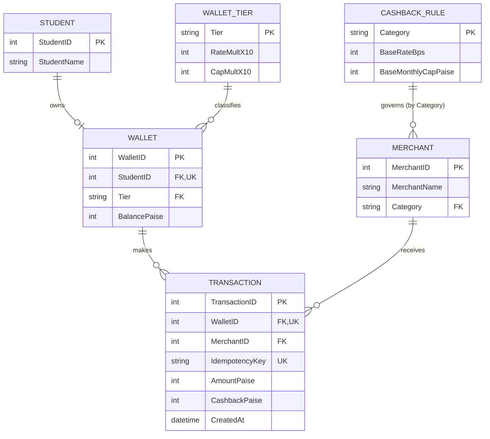

# Laboratory 4 — AI-Assisted Detailed Design
**Data Design • Algorithm Design • Security Design**  
*Simplified Integrated Laboratory Manual*

---

## 📌 Project Overview
* **Project Name:** FinPay – Campus Digital Wallet and Cashback System
* **Architecture:** Layered Architecture (`Router` $\rightarrow$ `Service` $\rightarrow$ `Repository` $\rightarrow$ `Model` $\rightarrow$ `Database`)
* **Authentication:** Reuses existing JWT infrastructure (as required in Lab 3)
* **Aim:** Develop and validate implementation-ready detailed designs from approved requirements and the Lab 3 architecture. AI proposes alternatives; students identify silent decisions and approve the final design.

---

## 1. Inputs, Method and Submission

| Input | Output |
| :--- | :--- |
| Approved requirements, Prompt Records, Lab 3 architecture, ADRs and ARR | One consolidated Detailed Design Record (DDR) plus final design artifacts |

**Common Method:** Design Need $\rightarrow$ AI Alternatives $\rightarrow$ AI Silent Decision $\rightarrow$ Student Review (`ACCEPT` / `MODIFY` / `REJECT`) $\rightarrow$ Final Design.  
*Rule:* Request alternatives only for significant decisions. Do not generate implementation code within design phase.

---

## 2. Part A — AI-Assisted Data Design

### A1. Data Needs and Storage Alternatives
Identify structured transactional data, documents/files and any genuinely specialized search or other workload. RDBMS-only is valid; polyglot persistence requires a justified need.

| Option | Design | When Suitable |
| :---: | :--- | :--- |
| **A** | **RDBMS only** | Structured relationships, integrity and ACID transactions |
| **B** | RDBMS + file/object store | Relational records plus substantial documents/files |
| **C** | RDBMS + specialized store | Approved search/vector/graph or other specialized workload |

#### FinPay Data Needs and Decision
| Data Need (FinPay) | What FinPay Stores or Does | Store Choice |
| :--- | :--- | :---: |
| **Structured transactional data** | Wallets and tiers, merchants and categories, cashback rules, payment transactions; balance updates, duplicate-payment protection (idempotency) and monthly cashback totals per wallet and category. | **RDBMS** |
| **Documents / files** | None in the FinPay scenario (no receipts, statements or uploads). | *Not required* |
| **Specialized search / vector / graph workload** | None. Access is by key plus a monthly `SUM` of cashback. | *Not required* |

> **Decision: Option A – RDBMS only.**  
> A payment must record the transaction, update the wallet and respect the monthly cashback cap as one unit, so ACID transactions and constraints (`PK`, `FK`, `UNIQUE`, `CHECK`) are needed. FinPay has no document or specialized workload, so Options B and C are not justified and no polyglot data map is required.

---

### A2. ER Modelling Using AI

**Prompt:** *“Using the approved requirements below, propose entities, attributes, keys, relationships and cardinalities. Resolve M:N relationships and state PK/FK/UNIQUE constraints. Do not invent business rules; list assumptions.”*

| ER Design Item | AI Decision / Assumption | Student Action (`A`/`M`/`R`) | Reason / Correction |
| :--- | :--- | :---: | :--- |
| **Entity / attribute** | Propose `STUDENT` (name, email, department …), `WALLET`, `MERCHANT`, `CASHBACK_RULE` and `TRANSACTION`. | **MODIFY** | The FinPay scenario only needs to identify the student who owns a wallet, so `STUDENT` keeps `StudentID` and `StudentName`. Email, department and other attributes are managed by the shared auth service and removed here. |
| **Entity / attribute** | Keep `RateMultX10` and `CapMultX10` as columns of `WALLET`. | **MODIFY** | They depend on Tier, not on `WalletID`. Moved to a `WALLET_TIER` lookup table (`BASIC 10/10`, `PRIME 15/15`, `PREMIUM 20/20`). |
| **Entity / attribute** | Add a `MONTHLY_CASHBACK` table (`WalletID`, `Category`, `Month`, `TotalPaise`) to track the cap. | **REJECT** | Derived data: month-to-date cashback is `SUM(CashbackPaise)` over `TRANSACTION` for that wallet, category and month. A stored counter can drift out of step with transactions. |
| **Entity / attribute** | `TRANSACTION` stores `AmountPaise` and `CashbackPaise` (awarded, after the monthly cap) as integer paise. | **ACCEPT** | Awarded cashback depends on month-to-date total and rules at payment time, so it is kept as historical record. Integer paise avoids floating-point errors. |
| **Relationship / cardinality** | `STUDENT 1:1 WALLET`; `WALLET_TIER 1:N WALLET`; `WALLET 1:N TRANSACTION`; `MERCHANT 1:N TRANSACTION`; `CASHBACK_RULE 1:N MERCHANT`. | **MODIFY** | `STUDENT`–`WALLET` corrected to `1 : 0..1` because a student may not yet have opened a wallet. No M:N relationship exists, so no junction table is needed. |
| **Relationship / cardinality** | Add a `RuleID` foreign key in `TRANSACTION` pointing to `CASHBACK_RULE`. | **REJECT** | The rule is reached through `TRANSACTION` $\rightarrow$ `MERCHANT` $\rightarrow$ `CASHBACK_RULE` (`Category`). A direct FK is redundant and could disagree with the merchant’s category. |
| **Key / constraint** | `UNIQUE(IdempotencyKey)` across all transactions. | **MODIFY** | Keys are generated per request by the client, so uniqueness is scoped to the wallet: `UNIQUE(WalletID, IdempotencyKey)`. |
| **Key / constraint** | PKs: `WalletID`, `MerchantID`, `TransactionID`; natural PKs `Tier` and `Category` for lookup tables; `UNIQUE(StudentID)` on `WALLET`; `CHECK AmountPaise > 0`, `CashbackPaise >= 0`, `BalancePaise >= 0`. | **ACCEPT** | Tier and Category are small controlled values used directly by the rules. `UNIQUE(StudentID)` enforces one wallet per student; `CHECK` constraints keep money values valid in the database. |

#### Assumptions (Confirmed Against Requirements)
* **AS1:** Each student has at most one wallet. `STUDENT` holds only `StudentID` and `StudentName`; authentication reuses the existing JWT infrastructure (Lab 3).
* **AS2:** Category is one of `CANTEEN`, `STATIONERY`, `TRANSPORT`, `HOSTEL`, `ONLINE`, `TOPUP`; Tier is `BASIC`, `PRIME` or `PREMIUM`.
* **AS3:** Money is stored as integer paise; rates as integer basis points ($2.0\% = 200\text{ Bps}$); tier multipliers $\times 10$ ($1.5\times = 15$).
* **AS4:** The monthly cap applies per wallet, per merchant category, per calendar month of `CreatedAt` (consistent UTC). $\text{Cap} = \lfloor\text{BaseMonthlyCapPaise} \times \text{CapMultX10} \div 10\rfloor$.
* **AS5:** A wallet balance may never go negative (no overdraft allowed). Awarded cashback is credited to `BalancePaise` atomically.
* **AS6:** The physical table for `TRANSACTION` uses a non-reserved SQL name (`transactions` or `payment_transaction`).

#### Corrected ER Model Diagram


---

### A3. Normalization Using AI (Up to 3NF)

**Unnormalized relation:**  
`PAYMENT_ALL(TransactionID, IdempotencyKey, WalletID, StudentID, StudentName, Tier, RateMultX10, CapMultX10, BalancePaise, MerchantID, MerchantName, Category, BaseRateBps, BaseMonthlyCapPaise, AmountPaise, CashbackPaise, CreatedAt)`

#### Known Functional Dependencies:
* **FD1:** $\text{TransactionID} \rightarrow \text{IdempotencyKey}, \text{WalletID}, \text{MerchantID}, \text{AmountPaise}, \text{CashbackPaise}, \text{CreatedAt}$
* **FD2:** $\text{WalletID} \rightarrow \text{StudentID}, \text{Tier}, \text{BalancePaise}$ (and $\text{StudentID} \rightarrow \text{WalletID}$)
* **FD3:** $\text{Tier} \rightarrow \text{RateMultX10}, \text{CapMultX10}$
* **FD4:** $\text{MerchantID} \rightarrow \text{MerchantName}, \text{Category}$
* **FD5:** $\text{Category} \rightarrow \text{BaseRateBps}, \text{BaseMonthlyCapPaise}$
* **FD6:** $(\text{WalletID}, \text{IdempotencyKey}) \rightarrow \text{TransactionID}$
* **FD7:** $\text{StudentID} \rightarrow \text{StudentName}$

#### Normal Form Verification:
* **1NF: PASS** — All attributes are atomic; no repeating groups.
* **2NF: FAIL** — `WalletID`, part of candidate key `(WalletID, IdempotencyKey)`, alone determines `StudentID`, `Tier`, and `BalancePaise` (partial dependency, FD2).
* **3NF: FAIL** — Transitive dependencies: $\text{TransactionID} \rightarrow \text{WalletID} \rightarrow \text{Tier} \rightarrow \text{RateMultX10}$, etc.
* **Anomalies Eliminated:** 
  * *Update:* Changing a rate or tier multiplier no longer requires editing past transaction rows.
  * *Insert:* A merchant, rule, or tier can exist before any transaction takes place.
  * *Delete:* Deleting transactions preserves student, wallet, and merchant entities.

#### Final Normalized Relational Schema (3NF)

| Relation | Attributes | Keys & Constraints |
| :--- | :--- | :--- |
| **`STUDENT`** | `StudentID`, `StudentName` | **PK:** `StudentID`. `StudentName NOT NULL`. |
| **`WALLET_TIER`** | `Tier`, `RateMultX10`, `CapMultX10` | **PK:** `Tier`. `CHECK` both multipliers $> 0$.<br>Seed: `BASIC (10/10)`, `PRIME (15/15)`, `PREMIUM (20/20)`. |
| **`CASHBACK_RULE`** | `Category`, `BaseRateBps`, `BaseMonthlyCapPaise` | **PK:** `Category`. `CHECK BaseRateBps >= 0` and `BaseMonthlyCapPaise >= 0`.<br>Seed: `CANTEEN (200/5000)`, `STATIONERY (100/2000)`, `TRANSPORT (300/10000)`, `HOSTEL (50/20000)`, `ONLINE (100/3000)`, `TOPUP (0/0)`. |
| **`MERCHANT`** | `MerchantID`, `MerchantName`, `Category` | **PK:** `MerchantID`. **FK:** `Category` $\rightarrow$ `CASHBACK_RULE.Category`. `MerchantName NOT NULL`. |
| **`WALLET`** | `WalletID`, `StudentID`, `Tier`, `BalancePaise` | **PK:** `WalletID`. **FK:** `StudentID` $\rightarrow$ `STUDENT` (also `UNIQUE`). **FK:** `Tier` $\rightarrow$ `WALLET_TIER`. `CHECK BalancePaise >= 0`. |
| **`TRANSACTION`** | `TransactionID`, `WalletID`, `MerchantID`, `IdempotencyKey`, `AmountPaise`, `CashbackPaise`, `CreatedAt` | **PK:** `TransactionID`. **FK:** `WalletID` $\rightarrow$ `WALLET`; **FK:** `MerchantID` $\rightarrow$ `MERCHANT`. `UNIQUE(WalletID, IdempotencyKey)`. `CHECK AmountPaise > 0` and `CashbackPaise >= 0`. `Index(WalletID, CreatedAt)`. |

---

## 3. Part B — AI-Assisted Algorithm Design

### Critical Function: `calculate_cashback()`
Returns raw cashback for one transaction before monthly cap application. **Pure function: no database access.**

#### Algorithm Alternatives & Trade-offs
* **Alternative A (Single Expression):** $\lfloor\text{amount} \times \text{rate\_bps} \times \text{mult\_x10} \div 100{,}000\rfloor$. Single floor at the end; exact; eliminates rounding errors.
* **Alternative B (Two Steps):** Compute basic cashback first with floor, then multiply by tier multiplier with second floor. *Rejected* because two-step flooring can lose 1 paisa (e.g. ₹103 hostel on PRIME yields 76 instead of 77 paise).
* **Student Decision:** **Alternative A (`MODIFY`)**. Kept pure with single floor division.

#### Pseudocode
```pascal
CONSTANTS
    BPS_SCALE  := 10000      // 1 basis point = 0.01%
    MULT_SCALE := 10         // Multipliers stored x10: 1.0->10, 1.5->15, 2.0->20
    DIVISOR    := BPS_SCALE * MULT_SCALE // = 100000 (64-bit integer division)

FUNCTION calculate_cashback(amount_paise, category, tier) RETURNS integer paise
    // Preconditions
    IF amount_paise is not an integer OR amount_paise <= 0 THEN RAISE InvalidAmount
    IF category NOT IN RATE_TABLE THEN RAISE UnknownCategory
    IF tier NOT IN TIER_TABLE THEN RAISE UnknownTier

    // In-memory lookup (no DB queries)
    rate_bps := RATE_TABLE[category].base_rate_bps
    mult_x10 := TIER_TABLE[tier].rate_mult_x10

    IF rate_bps = 0 THEN RETURN 0 // e.g. TOPUP

    // Pure integer arithmetic with single floor division
    raw_paise := (amount_paise * rate_bps * mult_x10) DIV DIVISOR
    RETURN raw_paise
END FUNCTION
```

#### Monthly Cap Enforcement (`process_payment()`)
```pascal
// Applied atomically by caller in payment service
cap_paise := (base_monthly_cap_paise * cap_mult_x10) DIV MULT_SCALE
earned    := SUM(CashbackPaise) for this wallet, category, and calendar month
remaining := MAX(0, cap_paise - earned)
awarded   := MIN(raw_paise, remaining) // Persisted in TRANSACTION.CashbackPaise
```

#### Boundary & Edge Cases
| Input (`amount_paise`, `category`, `tier`) | Expected Result | Reason |
| :--- | :---: | :--- |
| `10000, CANTEEN, BASIC` | **200** | ₹100 $\times$ 2% = ₹2.00 |
| `10000, CANTEEN, PRIME` | **300** | 2% $\times$ 1.5 = 3% |
| `10000, CANTEEN, PREMIUM` | **400** | 2% $\times$ 2.0 = 4% |
| `333, CANTEEN, BASIC` | **6** | 6.66 paise floored to 6 |
| `49, CANTEEN, BASIC` | **0** | 0.98 paise floors to 0 (below 1 paisa) |
| `50, CANTEEN, BASIC` | **1** | Exactly 1.00 paisa: smallest amount earning cashback |
| `10300, HOSTEL, PRIME` | **77** | 0.5% $\times$ 1.5 = 0.75%; 77.25 floors to 77 |
| `10000, TOPUP, any tier` | **0** | Base rate is 0% |
| `amount_paise <= 0` | **`InvalidAmount`** | Precondition failed |
| Unknown category or tier | **`UnknownCategory` / `UnknownTier`** | Input validation error |
| `CANTEEN, BASIC`, cap 5000, earned 4900, raw 200 | **100** | Remaining cap = 100, awarded = `MIN(200, 100)` |
| `earned >= cap` | **0** | Monthly cap exhausted |

---

## 4. Part C — AI-Assisted Security Design

| Security Need | AI Alternatives & Trade-offs | Human Decision & Justification |
| :--- | :--- | :--- |
| **Authentication / Authorization** | **Alt A:** Reuse existing JWT infrastructure; resolve `WalletID` on the server from the token.<br>**Alt B:** Separate FinPay session/credentials.<br>*Trade-off:* Alt A eliminates redundant credential storage and prevents horizontal privilege escalation. | **Control A (`ACCEPT`):** Server strictly resolves `WalletID` from verified JWT claims. A student cannot read or debit another student's wallet. |
| **Sensitive-Data Protection** | **Alt A:** Minimal response payloads; keep sensitive tokens out of logs; no column encryption.<br>**Alt B:** Column-level encryption of balances.<br>*Trade-off:* Alt A allows native SQL `SUM` and `CHECK` constraints without complex key management overhead. | **Control A (`ACCEPT`):** Minimal responses and owner-only access protect balance privacy without breaking database aggregate queries. |
| **Integrity & Abuse Control** | **Alt A:** `UNIQUE(WalletID, IdempotencyKey)` + single atomic DB transaction with balance check.<br>**Alt B:** App-level check without database constraints.<br>*Trade-off:* Alt A enforces idempotency at the database engine level, preventing race conditions. | **Control A (`ACCEPT`):** Prevents double spending and duplicate charges under network retries or concurrent requests. |

---

## 5. One Consolidated Detailed Design Record (DDR)

| Design Area | AI Silent Decision | Human Decision | Action (`A`/`M`/`R`) | Reason / Trade-off |
| :--- | :--- | :--- | :---: | :--- |
| **Data Design** | Added `MONTHLY_CASHBACK` counter table; kept multipliers in `WALLET`; global `IdempotencyKey`. | RDBMS only; derive monthly total via `SUM()`; move multipliers to `WALLET_TIER`; scope idempotency to `UNIQUE(WalletID, IdempotencyKey)`. | **MODIFY** | Avoids stored counter drift; satisfies 3NF; ensures client idempotency keys are wallet-scoped. |
| **Algorithm Design** | Read month-to-date total and applied cap inside `calculate_cashback()`. | Keep `calculate_cashback()` pure; caller `process_payment()` applies the cap. | **MODIFY** | Enables unit testing of core math without mock databases; honors single-responsibility principle. |
| **Security Design** | Authorize by JWT identity and enforce idempotency with DB constraint and atomic commit. | Adopt: reuse JWT; no column encryption; enforce DB constraints. | **ACCEPT** | Aligns with Lab 3 architecture; zero added attack surface; robust under concurrency. |

### DDR Validation
* [x] **Consistent with approved requirements:** 3NF schema, integer paise, basis points, tier multipliers, and floor division.
* [x] **Consistent with Lab 3 architecture:** Layered pattern retained (`Router` $\rightarrow$ `Service` $\rightarrow$ `Repository` $\rightarrow$ `Model`).
* [x] **Unsupported assumptions removed:** Removed redundant counter tables and direct rule FKs.
* [x] **Sufficiently detailed for code generation:** 3NF DDL, pseudocode for all 12 edge cases, and 3 security controls specified.

**DDR Status:** ☑ **APPROVED**
